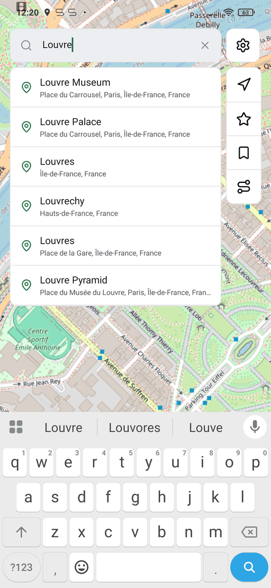
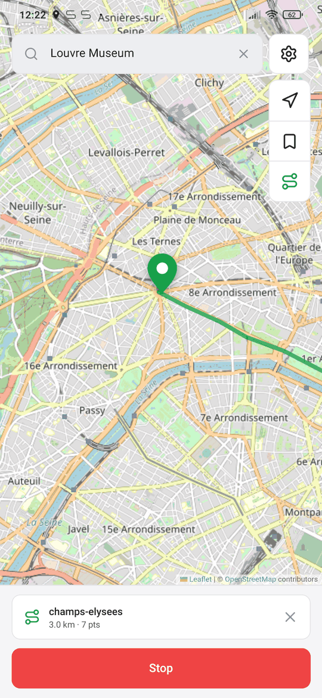
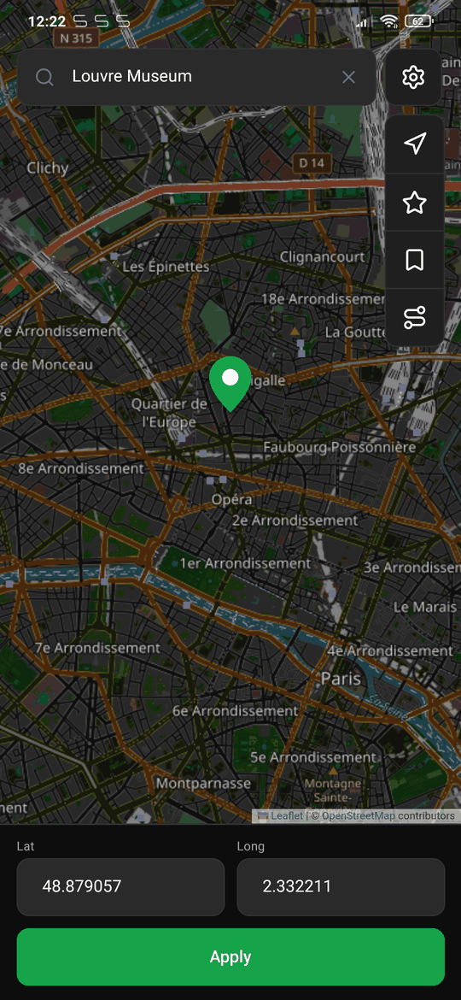
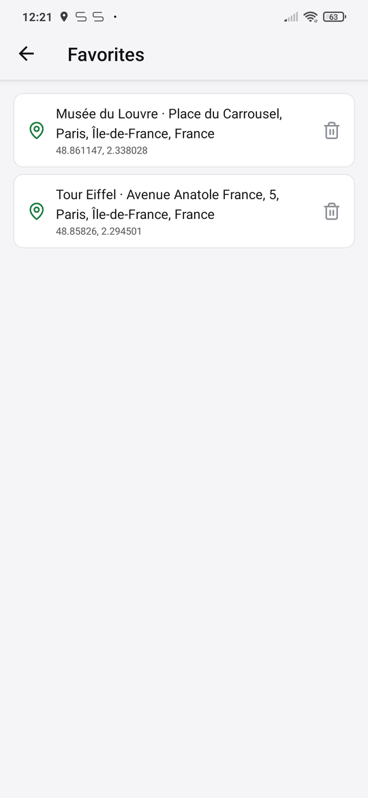
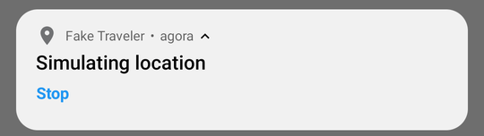

# Fake Traveler


Fake where your Android phone is located. Pick a point on the map, search an address or replay a
GPX route, and every app — Google Maps included — sees you there.

<table>
  <tr>
    <td></td>
    <td></td>
    <td></td>
  </tr>
  <tr>
    <td></td>
    <td></td>
    <td></td>
  </tr>
</table>

## Features

- **Tap the map, type coordinates or search an address** — the search autocompletes as you type.
- **Runs in the background** as a foreground service with a notification and a Stop action, so the
  mock survives closing the app.
- **Works with Google Maps**: the location is also held in Google Play Services' fused provider,
  which is what most apps read.
- **Routes**: import a GPX, KML or KMZ file and the app walks it at the speed you choose, once or
  in a loop.
- **Movement**: move a fixed step on every update, optionally reporting it as speed.
- **Favorites**: save the current point, named after its address.
- **Share in and out**: share a place from Google Maps or Waze to Fake Traveler to jump there, or
  open the current point in any map app. `geo:` links open in the app too.
- **Home screen widget** to start and stop the last simulation, and an option to resume it after
  rebooting the phone.
- **21 languages**, light and dark themes, OpenStreetMap or satellite imagery.



## Requirements

Allow Fake Traveler to mock locations: [enable Developer options](https://developer.android.com/studio/debug/dev-options)
and pick this app in **Settings → System → Developer options → Select mock location app**.

<table>
  <tr>
    <td></td>
    <td></td>
  </tr>
</table>

If an app still jumps back to your real position, go to **Settings → Location** and turn off
**Wi-Fi scanning** and **Bluetooth scanning**.

## Development

Expo (SDK 57) + Expo Router + NativeWind + zustand, managed with [bun](https://bun.sh). The mock runs
in a local Expo module written in Kotlin (`modules/mock-location`): a foreground service, the route
walker, the home screen widget and the boot receiver. The map is Leaflet inside a WebView; address
search uses [Photon](https://photon.komoot.io).

```sh
bun install
bun run check    # typecheck + oxlint + oxfmt + bun test
bun run start    # Metro for a development build
```

Native builds run on CI only:

- `ci.yml`: typecheck, lint, format and tests on every push.
- `build-aab.yml` (manual): signed AAB uploaded to Google Play (`com.diegohorvatti.fakeTraveler`),
  then records versionCode, versionName and the native fingerprint on the default branch.
- `ota-update.yml`: on push to the default branch, publishes an EAS Update when the native
  fingerprint still matches the last AAB.
- `build-apk.yml` (manual, `release` or `development`, or a `v*` tag): installable APK for testing.

Secrets: `ANDROID_KEYSTORE_BASE64`, `ANDROID_KEYSTORE_PASSWORD`, `ANDROID_KEY_ALIAS`,
`ANDROID_KEY_PASSWORD`, `PLAY_SERVICE_ACCOUNT_JSON`, `EXPO_TOKEN`.

## License

Copyright © 2018 Matías Castillo Felmer and contributors. Rewritten in 2026 by Diego Horvatti.

> This program is free software: you can redistribute it and/or modify
> it under the terms of the GNU General Public License as published by
> the Free Software Foundation, either version 3 of the License, or
> (at your option) any later version.
>
> This program is distributed in the hope that it will be useful,
> but WITHOUT ANY WARRANTY; without even the implied warranty of
> MERCHANTABILITY or FITNESS FOR A PARTICULAR PURPOSE. See the
> GNU General Public License for more details.
>
> You should have received a copy of the GNU General Public License
> along with this program. If not, see <https://www.gnu.org/licenses/>.

The original launcher icon was created by [@ArtistDev44](https://portfolio-guillaume-renoult.vercel.app/)
(see mcastillof/FakeTraveler#77) — thank you very much for your work!
